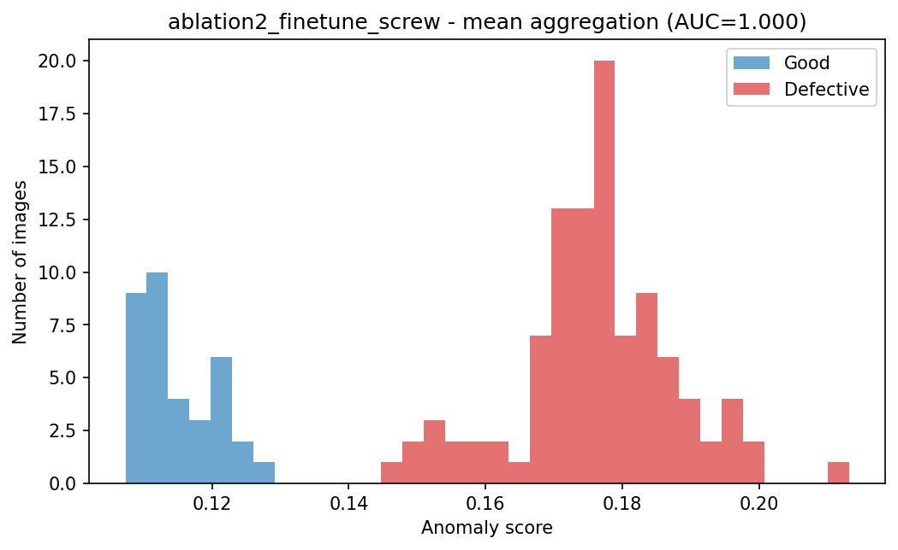
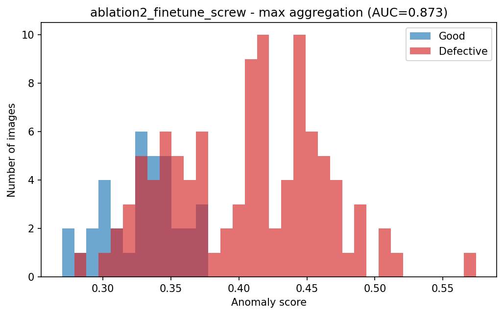
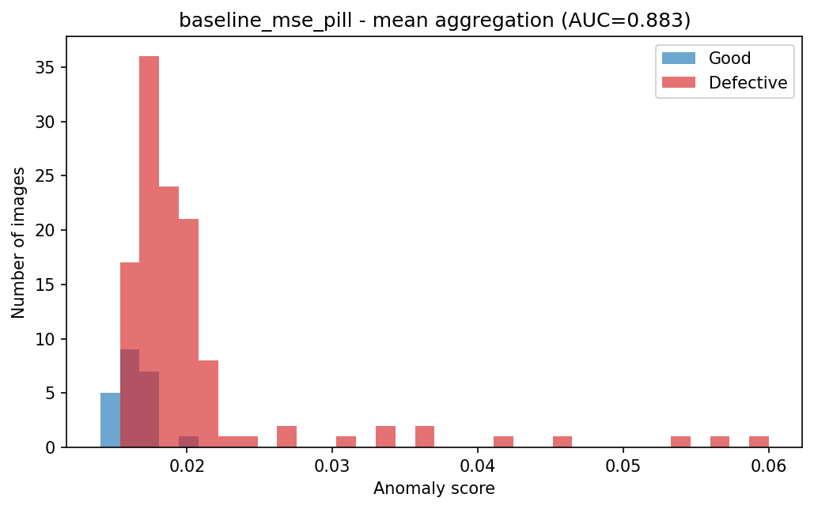
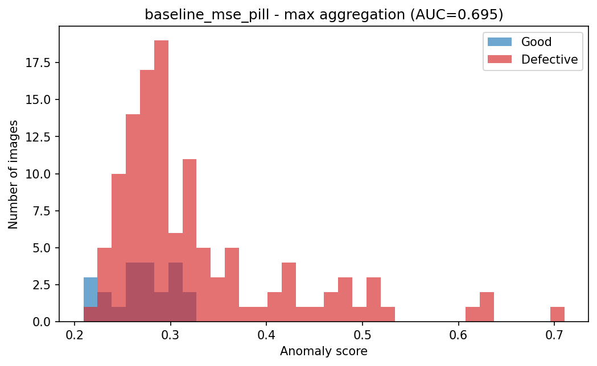

# DefectLens

Unsupervised, reconstruction-based anomaly detection for manufacturing defect detection, built on the MVTec AD benchmark (`screw` and `pill` categories).

A pretrained encoder (ResNet18 truncated at `layer3` by default) encodes an image into a spatial feature map; a custom `ConvTranspose2d` decoder reconstructs it. Trained only on defect-free images, the model learns what "normal" looks like — at inference, wherever a reconstruction disagrees with its input is the anomaly signal. No labeled defects are used at training time.

## Why this approach

Real manufacturing defects are rare and varied — a supervised classifier only ever recognizes the specific defect types it was shown during training. Reconstruction-based detection sidesteps this: it only needs to learn what "good" looks like, so it generalizes to defect types it has never seen. See [`ENGINEERING_DECISIONS.md`](./ENGINEERING_DECISIONS.md) for the full reasoning and every other design decision made in this project.

## Architecture

```
Input [3, 256, 256]
  → Encoder (pretrained, truncated to /16 downsampling, frozen by default) → [C, 16, 16]
  → Bottleneck (1×1 conv, tunable latent_channels)                         → [latent_ch, 16, 16]
  → Decoder (custom ConvTranspose2d stack, Sigmoid output)                 → [3, 256, 256]
```

Anomaly score = aggregated (max or mean) per-pixel reconstruction error, evaluated via AUC-ROC — a continuous ranking metric, not a fixed good/defective classifier (see Scope Notes in [`ENGINEERING_DECISIONS.md`](./ENGINEERING_DECISIONS.md)).

### Encoder options

The encoder is swappable via `--encoder_backbone`; the 1×1 bottleneck absorbs the channel-count difference so the decoder never changes.

| Backbone | Flag | Cut point | Output channels | Role |
|---|---|---|---|---|
| ResNet18 (ImageNet) | `--encoder_backbone resnet18` (default) | after `layer3` | 256 | Primary encoder |
| EfficientNet-B0 (ImageNet) | `--encoder_backbone efficientnet_b0` | after `features[5]` | 112 | Backbone-comparison ablation only |

Freeze behaviour is controlled by `--freeze_encoder` (default) / `--no_freeze_encoder`. With ResNet18, `--no_freeze_encoder` unfreezes only `layer3` (stem, `layer1`, `layer2` stay frozen to avoid forgetting generic low-level features). With EfficientNet-B0 it unfreezes the whole truncated encoder.

## Results

| Category | Best config | max AUC | mean AUC |
|---|---|---|---|
| **Screw** | Composite loss (L1+SSIM) + fine-tuned ResNet18 | 0.8727 | **1.0000** |
| **Pill** | Baseline (MSE, frozen ResNet18) | 0.6947 | **0.8826** |

Full comparison table across every ablation: [`results.md`](./results.md).

**Headline finding:** no single configuration wins for both categories. Composite loss and fine-tuning substantially improve screw (structural, localized defects) but actively degrade pill (color/intensity-based defects) below its own MSE baseline — evidence and mechanism in [`ENGINEERING_DECISIONS.md`](./ENGINEERING_DECISIONS.md).

### Score distributions (good vs defective)

Each histogram shows the anomaly scores of all test images for the best config of that category. The more the red (defective) and blue (good) distributions overlap, the weaker the separation.

**Screw** — composite loss + fine-tuned ResNet18

| Mean aggregation | Max aggregation |
|---|---|
|  |  |

**Pill** — baseline (MSE, frozen ResNet18)

| Mean aggregation | Max aggregation |
|---|---|
|  |  |

Note: screw under mean aggregation separates cleanly, but the margin between the lowest defective score and the highest good score is narrow, and `manipulated_front` remains the weakest defect type under max aggregation. Read the histograms alongside the per-defect-type tables in [`results.md`](./results.md).

## Ablations run

- Baseline: MSE loss, frozen ResNet18
- Composite loss (L1 + SSIM)
- Partial fine-tuning (encoder `layer3` unfrozen)
- Backbone swap (EfficientNet-B0)
- All levers combined (composite loss + fine-tuning + EfficientNet-B0), per category

Each ablation is a config flag on the same training script (`src/training/train.py`), not a separate implementation — see repo structure below.

## Repo structure

```
src/
├── data/
│   ├── dataset.py          # stratified val/test split, dual normalization
│   └── transforms.py
├── models/
│   ├── encoder.py          # ResNet18 (primary) + EfficientNet-B0 (ablation)
│   ├── bottleneck.py       # tunable 1x1 conv
│   ├── decoder.py          # ConvTranspose2d stack
│   └── autoencoder.py      # wires the above together
├── losses/
│   ├── mse_loss.py
│   └── ssim_composite_loss.py
├── training/
│   ├── train.py            # main training loop, checkpoints on best val AUC-ROC
│   ├── freeze_utils.py     # encoder freeze / partial-unfreeze logic
│   └── scheduler.py        # LR scheduling
├── eval/
│   ├── metrics.py          # score aggregation (max/mean), AUC-ROC
│   ├── evaluate.py         # full test-set evaluation + figure export
│   └── visualize.py        # saved plots: heatmaps, gallery, score histograms
notebooks/
└── collab_runner.ipynb     # Drive mount, repo pull, entrypoint calls
docs/
└── images/                 # figures embedded in this README
results.md                  # full ablation results table
ENGINEERING_DECISIONS.md    # design decisions + empirical findings, with evidence
```

## Setup

```bash
pip install -r requirements.txt
```

(On Colab specifically, use `pip install -r requirements.txt --break-system-packages` if needed, and note `torch`/`torchvision` are usually already installed in the runtime image — only `pytorch-msssim` and `wandb` typically need adding.)

## Running it

Training and evaluation run on Colab (GPU); code is authored and versioned separately via this repo.

```bash
# Train (any config is a flag combination on the same script)
python -m src.training.train --category screw --loss composite --epochs 50 --lr 1e-4 --run_name my_run

# Evaluate a checkpoint on the held-out test set
python -m src.eval.evaluate --checkpoint /path/to/my_run_best.pt
```

Checkpoints, val/test splits, and results are persisted to Google Drive across sessions; the raw MVTec AD dataset (`screw`, `pill` categories) is expected at a local path passed via `--data_root`.

### Evaluation outputs

`evaluate.py` writes, per checkpoint, to `<output_dir>/` (default `/content/drive/MyDrive/defectlens/results/`):

- `<run_name>_test_results.json` — overall and per-defect-type AUC-ROC under both max and mean aggregation.
- `figures/<run_name>/` — PNG figures, generated for both aggregation methods:
  - `scores_max.png`, `scores_mean.png` — good vs defective score histograms
  - `gallery_max.png`, `gallery_mean.png` — top-scoring image per defect type (target, reconstruction, error map)
  - `best_detected_*.png`, `worst_detected_*.png`, `good_example_*.png` — single-image examples

Error heatmaps share one color scale across all images in a run, so brightness is comparable between good and defective images. Figures are saved to disk rather than shown with `plt.show()`, because evaluation runs in a subprocess with no interactive plotting backend. Pass `--no_save_visuals` to skip figure generation.

To display them in a Colab notebook:

```python
from IPython.display import Image, display
display(Image("/content/drive/MyDrive/defectlens/results/figures/<run_name>/scores_mean.png"))
```

### Refreshing the README images

The images above are copies of the generated histograms. After evaluating the two best checkpoints, copy them into the repo:

```bash
F=/content/drive/MyDrive/defectlens/results/figures
mkdir -p docs/images
cp $F/ablation2_finetune_screw/scores_mean.png docs/images/screw_scores_mean.png
cp $F/ablation2_finetune_screw/scores_max.png  docs/images/screw_scores_max.png
cp $F/baseline_mse_pill/scores_mean.png        docs/images/pill_scores_mean.png
cp $F/baseline_mse_pill/scores_max.png         docs/images/pill_scores_max.png
```

## Dataset

[MVTec AD](https://www.mvtec.com/company/research/datasets/mvtec-ad) — `screw` (320 train / 160 test) and `pill` (267 train / 167 test) categories.